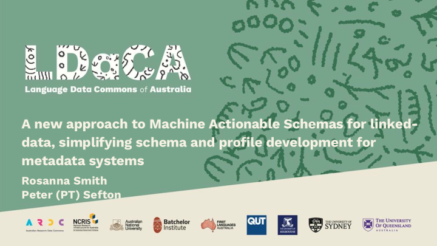
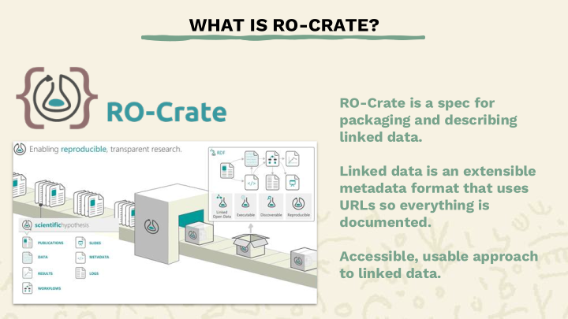
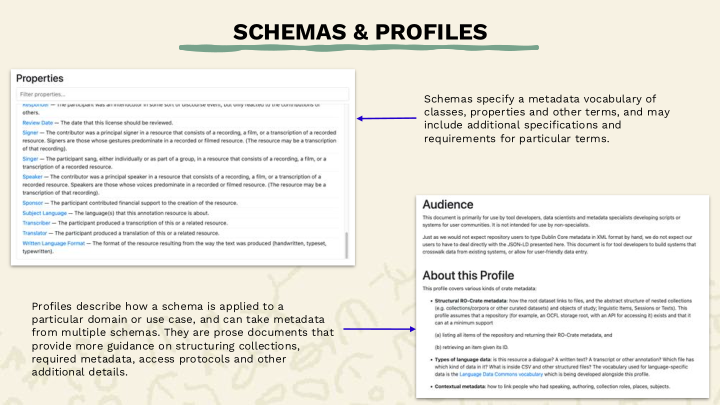
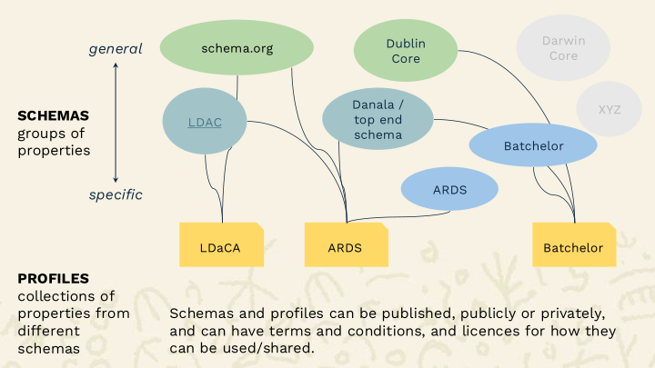
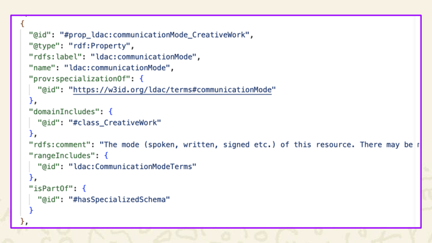
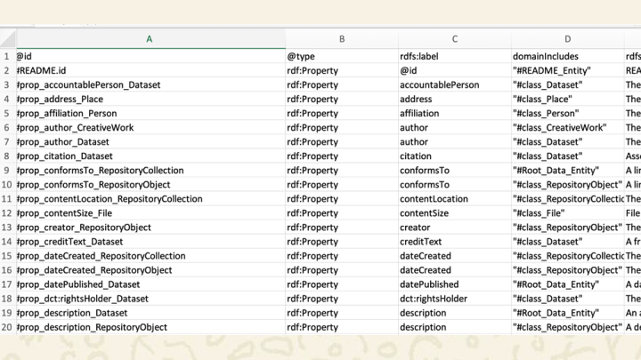
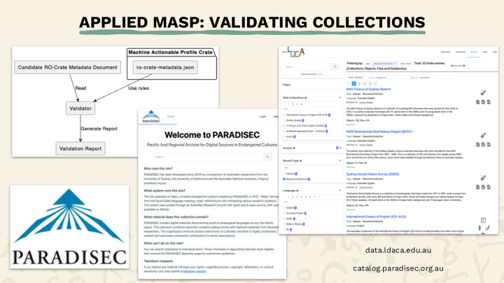
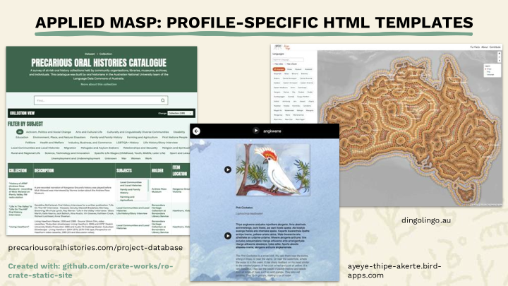
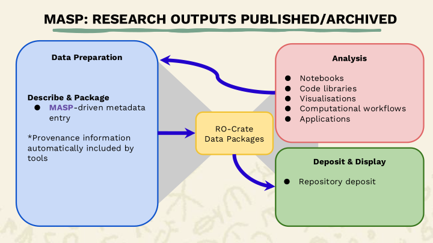
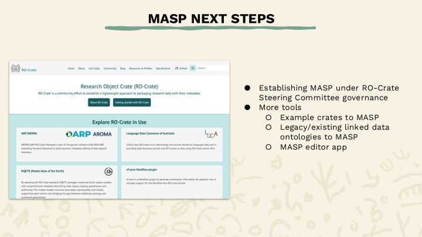

<a href="MASP Presentation.pdf">PDF version</a> | <a href="MASP Presentation.pptx">Powerpoint Version</a>

This presentation was delivered at eResearch 2026 in Melbourne by PT as Rosanna was unable to attend. We wrote the presentation together with the help of the Language Data Commons of Australia (LDaCA) team. Our attendance at the confence was paid by the LDaCA (University of Queensland), supported by coinvestment from the Australian Research Data Commons (ARDC).

<section typeof='http://purl.org/ontology/bibo/Slide'>
 

The Research Object Crate ([RO-Crate](https://www.researchobject.org/ro-crate/)) specification is now widely used for interchanging Research (data) Objects (ROs), and has been used as the basis for several projects in the Australian Research Data Commons (ARDC) Humanities and Social Sciences & Indigenous Research Data Commons (HASS&I RDC). RO-Crates are based on linked-data  and offer a simple, easy-to-implement way of packaging data for interoperability in line with the FAIR principles. They offer a consistency for deposit in repositories, and re-use in analytical pipelines and as the basis for web sites. Until now the RO-Crate community has lacked a similarly simple approach to validating ROs for consistency, or configuring editing environments and other tools used to produce data packages. In this presentation we show a new approach to describing general purpose linked data schemas and specific data profiles for particular domains and systems known as RO-Crate Machine Actionable Schemas and Profiles (MASP), using examples ranging from Indigenous Knowledge systems, to describing research software implemented, all in line with World Wide Web Consortium standards for metadata profiles. We will show easy-to-use tools, and show how schemas and profiles can be maintained using easy-to-understand spreadsheets. RO-Crate MASP tooling includes generating human-readable documentation, a validator and a compatible RO-Crate editor (Crate-O).

</section>

<section typeof='http://purl.org/ontology/bibo/Slide'>
 

This work came of the [LDaCA project](https://ldaca.edu.au) but what we’re talking about today is a general-purpose approach to linked data.

</section>

<section typeof='http://purl.org/ontology/bibo/Slide'>
 

LDaCA has a range of collaborators across several universities and institutes.

</section>

<section typeof='http://purl.org/ontology/bibo/Slide'>
 

Linked data helps us meet all of the challenges for language data highlighted above, from collecting and organising data to analysing it.

In the two decades since Tim Berners Lee’s publication on Linked Data principles, adopting the principles has been hard and involves specialised tooling that has not been particularly mainstream.

At LDaCA, we’re working with linked data through the use of RO-Crate or Research Object Crate, and this approach helps address the language data challenges shown here.

</section>

<section typeof='http://purl.org/ontology/bibo/Slide'>
 

RO-Crate is an open [Linked Data](https://en.wikipedia.org/wiki/Linked_data) based specification for packaging, storing and interchanging data (and is thus aligned with the goals of LDaCA and other Data Commons projects).

RO-Crate was designed from the start to be accessible to developers who are not linked-data aware, using the JSON-LD (or Linked Data) variant of JSON for encoding metadata descriptions, rather than XML (which is dated and has patchy support) or more esoteric RDF (or Resource Description Framework) encodings.

We won’t go into huge detail on RO-Crate this talk, but will focus on how the semantics of RO-Crates can be formalised using Schemas and Profiles.

</section>

<section typeof='http://purl.org/ontology/bibo/Slide'>
 

The frameworks we use for metadata come under schemas and profiles.

Schemas are how metadata is structured and standardised at the highest level. They can specify requirements for metadata fields, e.g. date published must have a date format value.
Different disciplines can have different standards as well.

</section>

<section typeof='http://purl.org/ontology/bibo/Slide'>
 

Schemas can range from very general like [schema.org](https://schema.org) and [Dublin Core](https://www.dublincore.org/specifications/dublin-core/dcmi-terms/), to more specific like the Lanaguage Data Commons Schema (LDAC) <https://w3id.org/ldac/terms> which focuses on language-related metadata, and private schemas like ARDS which describes clan and kinship terms for example.

Profiles are subsets of standards and are more tailored to specific use cases, for example, the profile used by LDaCA <https://w3id.org/ldac/profile> is designed specifically to provide guidance on how to structure and describe language collections.

The LDAC profile uses schema.org and parts of Dublin Core as its foundation for metadata, but it also pulls from the LDAC schema for terms specific to describing language data.
Profiles also provide guidance on structuring collections, required metadata, access protocols and additional details about the metadata, for example, terms intended to describe a file as opposed to a person.

Whereas schemas focus on defining the metadata terms and their individual requirements, profiles provide more overall context for how the metadata should be used and guidance on structuring particular collections.

Profiles also have the ability to take metadata from various schemas and codify that for use with particular types of datasets.

</section>

<section typeof='http://purl.org/ontology/bibo/Slide'>
 

The next stage in development of schemas and profiles is RO-Crate MASP, which stands for machine actionable schemas and profiles.

Previously, schemas and profiles have been created separately with scripts for generating the documentation specific to a single profile or schema, but MASP brings these together so the same scripts can be used to generate multiple documents.

This approach is currently being used for the LDAC schema for language data, as well as the schemas of ARDS Aboriginal Corporation and Batchelor Institute, both of which are closely developed with knowledge holders to describe clan and kinship terms that reflect ancient and ongoing cultural knowledge systems.

The diagram here shows how a profile is generated - it takes a JSON file of the metadata terms used in the profile which can be adapted from schemas, as well as a human-readable text file that provides more guidance and description of the profile. These two files are used by the script to generate the profile document, and that document and the JSON file become the profile crate.

</section>

<section typeof='http://purl.org/ontology/bibo/Slide'>
 

This slide shows what a MASP profile component looks like “under the bonnet”. It’s JSON-LD. This is defining a property `communicationMode` which is defined in the Language Data Commons Schema. It's full URI is <https://w3id/org/ldac/terms#communicationMode>. It occurs in the domain of any schema:CreativeWork, and the value it points to is one of a set of `CommunicationModeTerms`. 

</section>

<section typeof='http://purl.org/ontology/bibo/Slide'>
 

This slide is a screenshot of the same property definition in an Excel format – it is possible to edit in either the text file or a spreadsheet, or in an RO-Crate editor.

</section>

<section typeof='http://purl.org/ontology/bibo/Slide'>
 

One of the other major uses for MASP that we’re currently working on is to drive tools for managing collections.

An example of this is Collection2Crate or C2C (available soon at [CrateWorks](https://crate-works.org/)), which is a browser tool that turns a folder of files on your computer into an RO-Crate, with optional data cleaning, processing and visualisation steps.

It’s built for people organising diverse collections of files who need consistent, publishable metadata without having to become RO-Crate experts themselves.

Depending on which MASP profile you select, this will determine which fields you can use to describe your collection, which plugins are available for processing the data, what gets written out, and what counts as a valid RO-Crate.

In the screenshot, the processing options available here are those configured for the LDAC profile for language data, so selecting another profile would change the options we see in this and other sections of C2C.

</section>

<section typeof='http://purl.org/ontology/bibo/Slide'>
 

MASP profiles can also be used to validate collections for deposit into repositories.
The diagram shows how the JSON file in a profile crate can be used as a set of rules to validate a collection that uses this profile, meaning that any missing required metadata, errors in how the collection has been structured, and other requirements can be flagged and corrected.

Both [PARADISEC](https://paradisec.org.au), the Pacific and Regional Archive for Digital Sources in Endangered Cultures, and LDaCA share the LDAC profile for language data, and this validation method is used for collections deposited into the Language Data Commons Portal.

</section>

<section typeof='http://purl.org/ontology/bibo/Slide'>
 

Another way MASP can be used is to indicate, or potentially package HTML templates that configure the design and layout of static sites for RO-Crated collections.

This method uses the ro-crate-static-site generator(available at the [CrateWorks](https://crate-works.org/) site) which takes an RO-Crate and provides a static HTML site configured according to that collection.

We can extend this further so that individual MASP profiles provide a set of templates available for collections using this profile, and these can then be further configured according to the requirements of the particular collection.

Several examples already using this method are [Precarious Oral Histories](https://precariousoralhistories.com/project-database), which catalogues at-risk oral history collections throughout Australia, the [Arrernte Bird Stories](https://ayeye-thipe-akerte.bird-apps.com/), providing names, calls and descriptions of birds in language, and [Dingo Lingo](https://dingolingo.au), which maps words for dingoes and dogs across Australia in Indigenous languages.

Each of these collections requires unique ways of presenting the information, including search, filtering, tabulation,  geographical mapping, and audio and visual media.
The static site approach, coupled with MASP profiles, allows for these unique requirements, so that while each of these sites uses the same static site generator, the configuration of each can be determined by the profile.

</section>

<section typeof='http://purl.org/ontology/bibo/Slide'>
 

This diagram shows the “narrow waist” of standardisation – on the left is data preparation which is focussed on organising and describing data for two main purposes:

1. Deposit into archival repository services where it can be found, 
2. Analysis; by which we mean pretty much any research process that uses the data to gain some insight. If data has been organised to a metadata profile, then systems such as C2C can turn on access to tools that work with data conforming to that profile.

Schemas:
-  Provide shared terms for findability and data interoperability
-  Provide guidance on structuring data 
-  Ensure that metadata terms are documented (by following the links to the schema)
Profiles:
-  Set expectations for what can be put into an archival repository in detail (and how schema terms can be combined)
-  Can have packaged resources such as display templates and pointers to data preparation tools like C2C

</section>

<section typeof='http://purl.org/ontology/bibo/Slide'>
 

This MASP workflow also lends itself to reuse of RO-Crate packaged data collections with the same analysis tools for greater interoperability.

Since all deposited collections already meet the MASP validation requirements, they will function with a range of ready-to-use notebooks, libraries, visualisations, workflows and apps, meaning that the same methods and tools can be applied to multiple collections.

</section>

<section typeof='http://purl.org/ontology/bibo/Slide'>
 

Following on from this, research outputs from any analysis done on RO-Crated collections can also be put through the data preparation workflow and published or archived as their own RO-Crate collections.

This workflow automatically adds provenance information in the RO-Crate, making it clear exactly what tools and parameters were used to create individual research outputs.

</section>

<section typeof='http://purl.org/ontology/bibo/Slide'>
 

In terms of next steps, we aim to establish governance for MASP under the RO-Crate steering committee to ensure further support and interoperability with existing frameworks. MASP in on track to become an official RO-Crate specification.

We are also working on new tools to create and use MASPs, for example, creating new schemas and profiles by reading existing RO-Crate collections and inferring the structure, conversion of existing legacy linked data ontologies to RO-Crate, and an editor app to create and modify profiles and schemas, lots of tools are being developed and are currently jumbled together in a [github repository](https://github.com/Language-Research-Technology/ro-crate-masp), which will be cleaned up and separated out into multiple projects soon.

</section>

<section typeof='http://purl.org/ontology/bibo/Slide'>
 

If you’d like to hear more about what LDaCA is working on, feel free to subscribe to our newsletter or get in contact with us.

</section>

