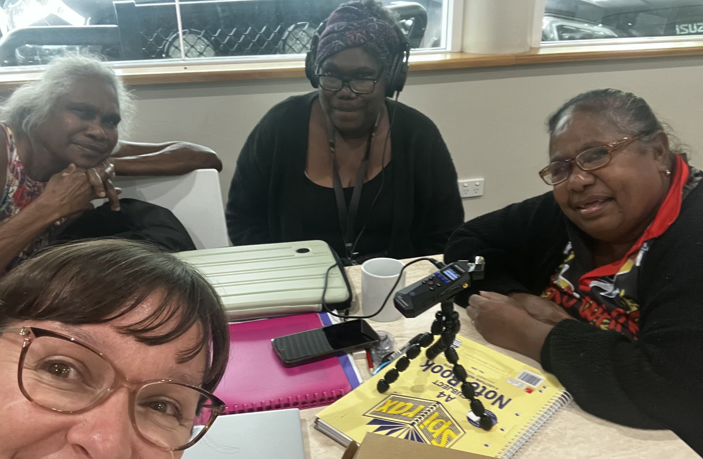

In July 2026, Katie Bicevskis — a linguist from the Research Unit for Indigenous Language at the University of Melbourne — travelled to Mareeba, Queensland to deliver training workshops to Kunjen Elders working on a revitalisation project for their language, Ow Oykangand. The primary goal of the revitalisation project is to plan and teach On Country language and culture workshops for Kunjen kids on traditional Kunjen country (Western Cape York Peninsula, inland from Kowanyama).

In the planning stages of the project, the team will record a speaker of their language producing target words and phrases and telling traditional stories. To support this work, Katie delivered a morning workshop on audio recording and data management. Topics included setting up a recording space well, using the equipment, recording metadata, saving and naming files, ideas for types of language recordings, and language resources that can be created with good quality recordings. In this workshop, Katie also discussed the importance of metadata, using spreadsheets to keep records on project data, and backing up and archiving data. Katie had previously worked with the Kunjen Elders at Paper and Talk 2024 at the Australian Institute of Aboriginal and Torres Strait Islander Studies (AIATSIS), where they gained access to a large number of language materials. These workshop topics therefore also gave the team members the skills to organise these written materials in order to interpret them in the future. Following this workshop, the afternoon was spent practising the recording and data management process from start to finish.

<figure>
  
  <figcaption>Kunjen Elders practising audio recording techniques with Katie (Image: Katie Bicevskis)</figcaption>
</figure>

Katie also delivered a workshop on sounds and spelling in Ow Oykangand, in order to support the Kunjen team members with pronunciation, reading and writing in Ow Oykangand. Workshop topics included place and manner of articulation to aid in identification and production of speech sounds, and generalisations about speech sounds used in Australian Indigenous languages, before focussing on sounds in Ow Oykangand. Discussion then turned to the distinction between speech sounds and spelling and how the Roman alphabet is used in different ways for different languages, followed by tips for mapping sounds and spelling in Ow Oykangand.

The team also spent time planning for the On Country workshops and familiarising themselves with new equipment for the project.

The workshops were well received by the team, who were enthusiastic to learn new skills to support their revitalisation goals. It was also a great chance for the whole team to be together in the one location and everyone is looking forward to meeting up again to continue the work in the future.

This project is supported by a Priority Language Support Project grant from First Languages Australia and by the Language Data Commons of Australia.