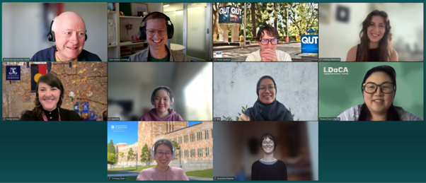

LDaCA has run its Graduate Digital Research Fellowship (GDRF) program in 2026, for the fourth consecutive year. As explained in [our post](https://www.ldaca.edu.au/news/posts/gdrf-2025/) about the 2025 iteration, we made some changes which were intended to expand the program but actually had little effect then. However, the changes certainly did have an effect this year — we received 24 expressions of interest which came from all over Australia. After filtering out applications that proposed work that either was out of scope or which could not be matched to a suitable mentor, we offered fellowships to eight people, meaning that the program was twice as big as it had ever been previously.

<figure>
  
  <figcaption>Top Row: Simon, Sam, Oscar, Lindsey
   
  Middle Row: Yvette, Sara, Mili, Teresa
   
 Bottom Row: Chili, Anastasia
</figcaption>
</figure>

One of the 2025 changes which supported expansion was to enlist colleagues from related projects and organisations to enlarge the pool of potential mentors for our fellows, and this was an essential component for the enlarged program this year. We had mentors from the [Australian Digital Observatory](https://www.digitalobservatory.net.au/) project at Queensland University of Technology (Robert Fleet), from [Melbourne Data Analytics Platform](https://www.unimelb.edu.au/mdap) (Emily Fitzgerald) and from [QCIF Digital Research](https://www.qcif.edu.au/) (Eve Ansell, a fellow in the first program back in 2023). Three additional mentors were involved through their various roles in the LDaCA team: Sam Hames, Ben Foley and Betsy Alpert. The final session of the program where the fellows gave short presentations about their work was also attended by all but one of the mentors — this had not been the case in previous years. Given this circumstance, having a reflection about each project from the mentor involved emerged as a natural part of the event and we certainly hope to make this a tradition for the program.

We were fortunate also to have wonderful contributions from two guest presenters in our group sessions. Ben Foley extended his mentorship to everyone, at least for a few hours, and spoke about ways of thinking about the link between digital research and communities who might benefit or potentially be harmed by the work. Ben explored how these issues manifested in some of the projects which he has worked on with various Indigenous communities over many years. [Tully Barnett](https://researchers.adelaide.edu.au/profile/tully.barnett) (University of Adelaide) was the second guest and her talk also distilled years of experience, in this case working in the fields of digital humanities and cultural studies. Two of the main themes of the talk were the importance (and challenges) of interdisciplinarity in digital research, and how a critical digital humanities can approach questions about working ethically with cultural data.

# Our 2026 fellows were:

**Oscar Davison (QUT)** is a PhD student in law whose research looks at the financing of climate change mitigation projects in the Pacific. The relevant documentation of the two projects which are the core of the research runs to almost 6,000 pages. Not surprisingly, Oscar was keen to explore the possibilities of using computational methods to help him review this data. With his mentor Robert Fleet (ADO/QUT), Oscar explored using text analytic methods to identify key points in the documents and to extract information efficiently. This work led to a presentation by Oscar and Robert to the QUT Centre for Justice Winter School, an annual programme designed to support research students in exploring new research methodologies. This presentation has become the basis for a possible publication. While we emphasise that the GDRF program is not output-focused, we are nevertheless delighted when such results do occur.

**Lindsey Stevenson (The University of Sydney)** is researching the use of inclusive language (écriture inclusive) in French social media. Lindsey’s research explores how innovation and contestation of language use play out in channels such as TikTok, where identities and linguistic norms are negotiated in spontaneous language practices. With Betsy Alpert as her mentor, she explored some of the methodological challenges in this area, including developing methods for analysing multimedia content.

**Yvette Walker (The University of Melbourne)** researches art and museum practices in the context of education. Her research has generated a large dataset of written responses to an exhibition and, in the fellowship program, she worked with Ben Foley to explore ideas about how digital technologies can be part of preserving this material and also making it available to new audiences. Central to this work is a consideration of how archives (or anarchives) can be starting points for new creative endeavours.

**Sara Kie (The University of Sydney)** is an economic historian working in a project examining the socio-economic impact of colonialism in Australia. She was keen to explore the use of digital methods in transforming archival sources, particularly hand-written materials, into structured data suitable for quantitative analysis. Sara planned to work with ships’ logs stored at the National Library of Australia, but recent changes to the NLA’s policy on providing API access to material meant that Sara only received an API key as her fellowship was ending. Fortunately, Sara and her mentor Emily Fitzgerald (MDAP) were able to find some genealogical records to use as an alternative data source.

**Putri Limilia (Mili) (The University of Sydney)** is a PhD student in government and international relations who is studying the use of [astroturfing](https://en.wikipedia.org/wiki/Astroturfing) in political communication and its impact on individuals. Mili worked with Sam Hames to annotate Twitter data from discussions of the 2024 Indonesian presidential election, aiming to identify coordinated political astroturfing. The analysis used the Coordination Network Toolkit developed by Sam.

**Teresa Chan (The University of Queensland)** is a member of the LDaCA team who is working on a research project intended as a demonstrator for our data and tools. Her research looks at a class of expressions known as general extenders — items like ‘and so on’ or ‘or something’ — and she worked with Sam as a mentor, particularly to improve her skills in designing search strategies and then implementing them in code. Teresa has already written about [her initial impressions](https://www.ldaca.edu.au/news/posts/gdrf-interview-teresa-april2026/) of the program.

**Chilmeg Elden (Chili) (The University of Queensland)** is a PhD student in linguistics who is researching the development of relationships across time by looking at the interactions of language exchange pairs. She worked with Eve Ansell (QCIF) to develop ways of visualising aspects of the interactions within each pair, both for supporting analysis and also for communicating findings.

**Anastasia Beasley (RMIT)** is a Masters student who is interested in how online communities iteratively develop their safety affordances to maintain a positive environment for participants. With her mentor Betsy Alpert, Anastasia explored these issues in the context of Queer community websites, both historical and current, looking particularly at the technological resilience of various solutions. Using the fan-run international RuPaul’s Drag Race Discord server as a starting point, she experimented with using dynamic Bayesian networks to model disruption and recovery.

# Towards 2027

Members of the Skills team from the Australian Research Data Commons’ (ARDC) HASS and Indigenous Research Data Commons [(HASS&I RDC)](https://ardc.edu.au/hass-and-indigenous-research-data-commons/) joined us for the final session of the program and were enthusiastic about what they saw and heard. In later discussions, we have been exploring ways in which the program could receive some administrative support from the ARDC and also the possibility that other focus areas in the HASS&I RDC might be involved. If these possibilities do eventuate, we expect that our 2027 program might be even bigger than this year’s. This is both a scary and an exciting prospect — scary because a larger program brings greater organisational complexity and more moving parts, but exciting because it will mean an opportunity to interact with more talented researchers and explore challenging questions with them.

Look out for an announcement and the opening of expressions of interest towards the end of this year or early next year.
