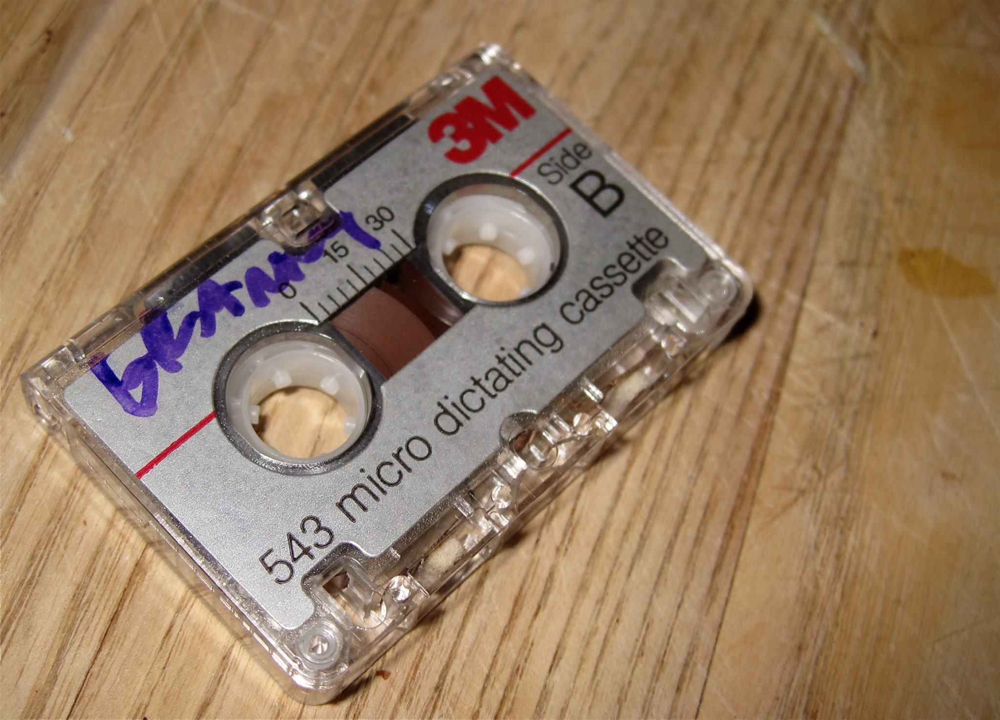

<figure>
  
  <figcaption>"Granny's tape" (Image: cogdogblog for Flickr)</figcaption> 
</figure>

The Precarious Oral Histories Project has progressed the next phase of its national initiative to identify oral history collections at risk of being lost or becoming inaccessible, with [a new survey](https://precariousoralhistories.com/collections-survey/) focused on New South Wales and the Australian Capital Territory.

Led by the Australian National University (ANU) team of the Language Data Commons of Australia (LDaCA), the project aims to build a clearer picture of where oral history collections are held, their preservation needs and the challenges facing their long-term care.

The initiative builds on the project's work in Victoria, where nearly 200 collections comprising more than 9,000 interviews were identified. These findings highlighted the significant volume of valuable historical recordings held outside major collecting institutions, often by community groups, local organisations, researchers and individuals.

The NSW and ACT survey invites collection holders to contribute information about their materials, including collections that may lack ongoing funding, dedicated archival support or long-term preservation arrangements.

Importantly, participation does not require collection holders to upload recordings or transfer ownership of their materials. Instead, the information gathered will contribute to the project's publicly searchable collections catalogue, helping to improve discoverability and build an evidence base for future preservation planning and advocacy.

Collection holders can complete the survey online or download a Word document to submit their responses.

[Learn more about the NSW and ACT Collections Survey.](https://precariousoralhistories.com/nsw-and-act-collections-survey-available/)
