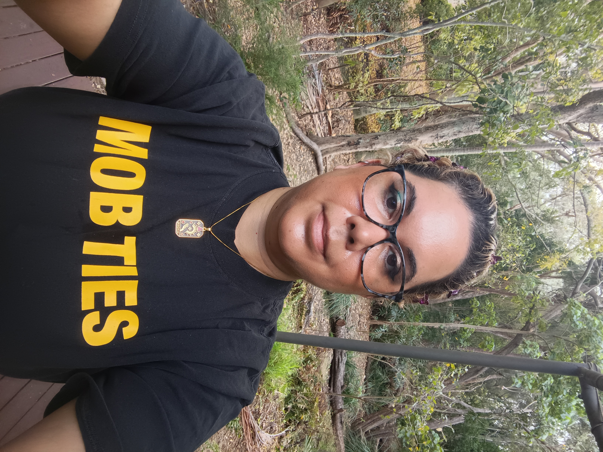
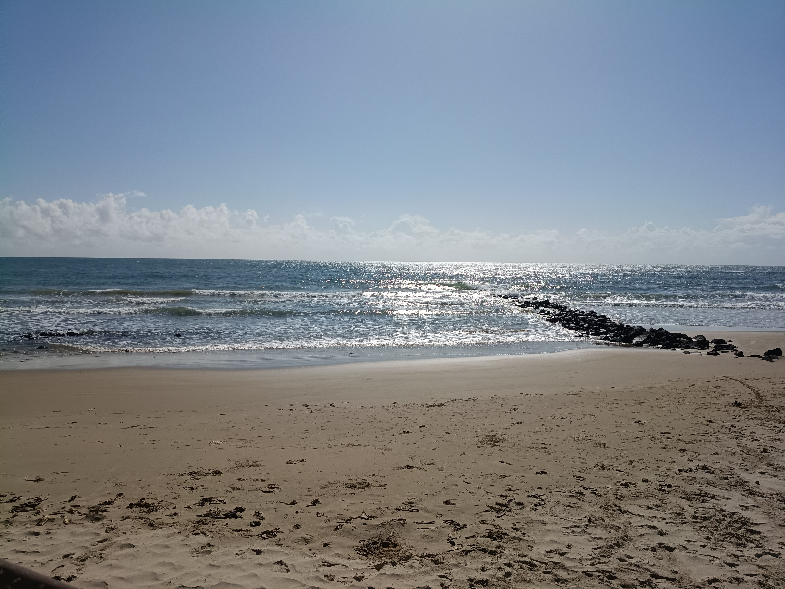
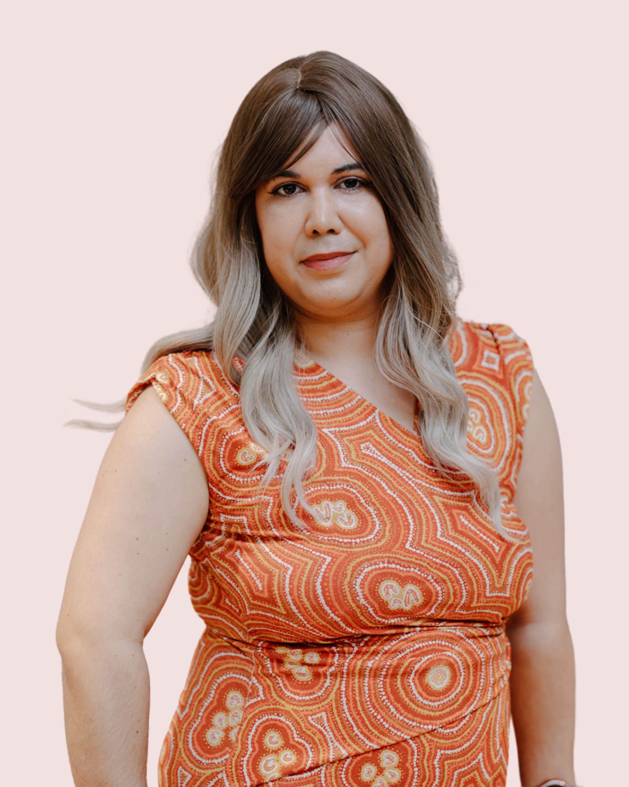

> *As part of a regular feature in our quarterly newsletter, we asked Australian Research Data Commons (ARDC) 2026 Indigenous Intern, Blanche Alexander, for a tip to pass on to readers. Read on to find out her tips for successful community-led engagement.*

This quarter’s tip focuses on community-led engagement, put into practice through recent  Dyirbal and Gooreng Gooreng Community Collections Language Data Workshops. These types of engagements create opportunities to yarn with mob about language, data and digital tools, listen to community priorities, and work together to enrich collection metadata. From exploring place-based relationships to demonstrating and handing over language portals, the focus is on supporting communities to describe their language materials in ways that reflect their knowledge, customary governance and aspirations.

<figure>
  
  <figcaption>Blanche on country in Bundaberg, Gooreng Gooreng Traditional Owner (Image: Blanche Alexander)</figcaption>
</figure>

## My tips
- Start with a yarn, not a technical solution — listen to what community needs before deciding what to build!
- Let community knowledge guide the metadata — people, places, ancestors and relationships matter.
- Make the return of language materials meaningful — create space for community to examine, enrich and recommend changes to their collections.
- Keep community authority front and centre — let community guide how materials are described, accessed and used.
- Make time away from the screen — relationships are the foundation of community-led work!

<figure>
  
  <figcaption>Bargara Bularm (Beach) (Image: Blanche Alexander)</figcaption>
</figure>

## Blanche ‘Yarra’ Alexander

<figure>
  
  <figcaption>Blanche Alexander (Image: Blanche Alexander)</figcaption>
</figure>

Blanche is a Gooreng Gooreng, Yidinji, Pitta Pitta and Mitakoodi woman and has joined the Australian Research Data Commons (ARDC) and LDaCA as the 2026 Indigenous Intern. Her background spans data analysis, cybersecurity, application development and community engagement. Blanche is currently completing a PhD at Griffith University focused on Indigenous Data Sovereignty and remote communities. She is passionate about First Nations digital rights and using technology to advance equitable, community-led outcomes across Australia. 
