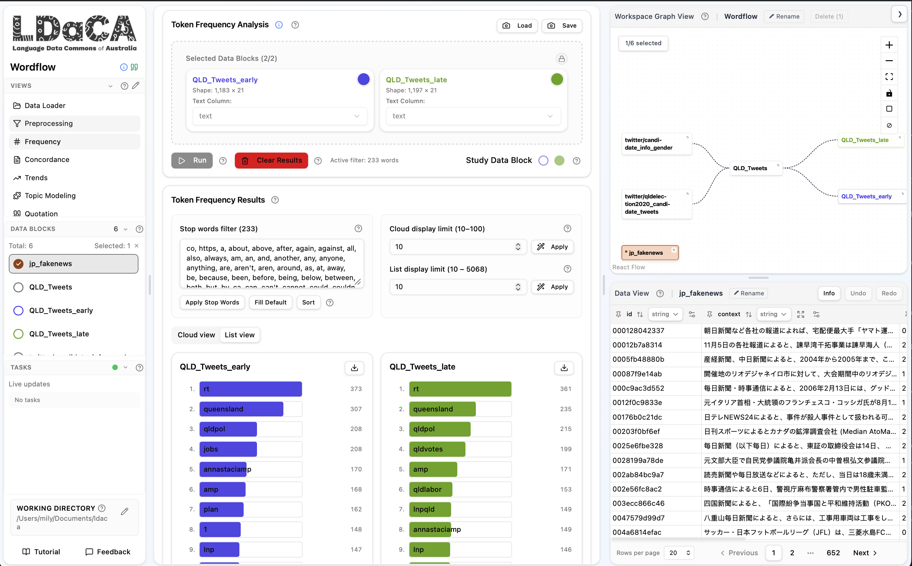

**Wordflow is a code-free interface for text analytics developed by the Sydney Corpus Lab and the Sydney Informatics Hub. It allows researchers to stack single purpose tools, including frequency, concordancing and topic modelling tools, for different views of their data.**

Many text analytics tools require a knowledge of programming. This can be a significant barrier to Humanities, Arts and Social Sciences (HASS) researchers who want to use text data to enrich their research. Within this context, the team at Sydney Informatics Hub and Sydney Corpus Lab started developing the Wordflow app in 2025, releasing it in 2026. Wordflow brings together earlier tools released as individual Jupyter notebooks in a cohesive analytical environment which allows for both quantitative and qualitative analysis. It therefore supports HASS researchers to analyse language at scale without having coding experience, or a dedicated member of their team who provides technical support. 

Wordflow can be run in three different ways — on the cloud using BinderHub, as a desktop app, and through Python. This allows researchers to work with different size corpora as required. It combines tools used in Corpus Linguistics, such as the concordancer and key word analysis, with Natural Language Processing (NLP) techniques, including a new annotation tool which uses AI to help code text data.

<figure>
    
    <figcaption>The workspace at a glance — tool sidebar, analysis panel, the workspace graph, and the data viewer, all on one screen</figcaption>
</figure>

# Outcomes and learnings

The latest release of Wordflow connects to LDaCA collections in our Data Portal through the LDaCA API. This means that researchers can follow a pipeline from data discovery and access to analysis and visualisation through LDaCA infrastructure, which we are beginning to integrate across projects.

Wordflow also contributes significantly to reproducible workflows across HASS research. The visual project graph allows the user to track their process and export it to share with collaborators, who can then reproduce the analysis. 

# Key resources

[Wordflow walkthrough](https://www.youtube.com/watch?v=ExYVSgvYIes)

[AI Annotator tutorial](https://www.youtube.com/watch?v=KcjJViYRYX4)

[Source code](https://github.com/Australian-Text-Analytics-Platform/LDaCa_Text_Analytics_Tools)