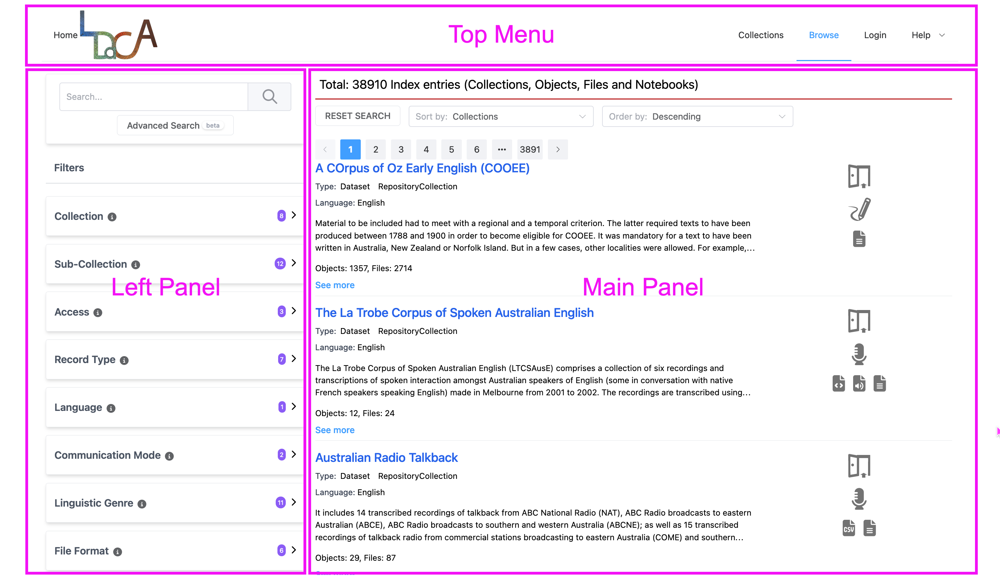
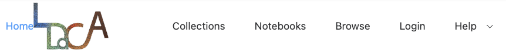
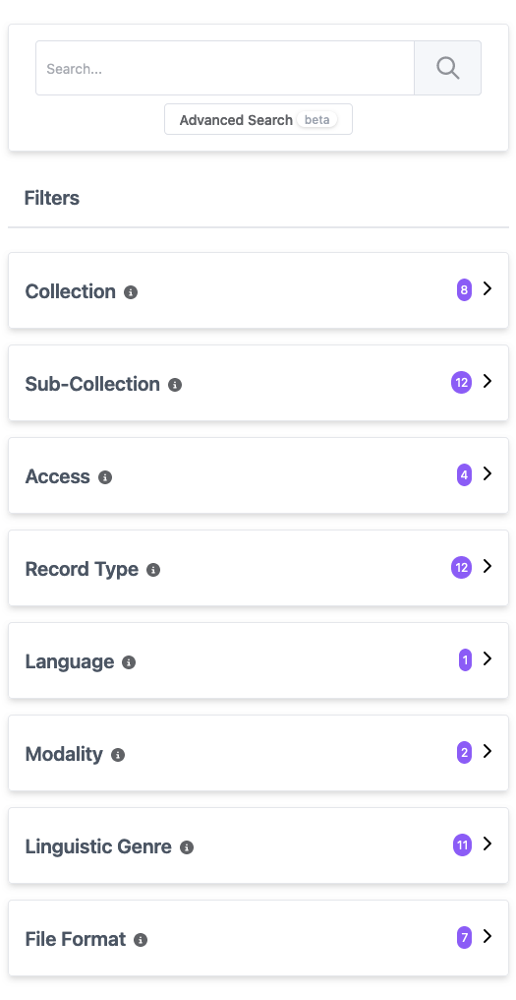
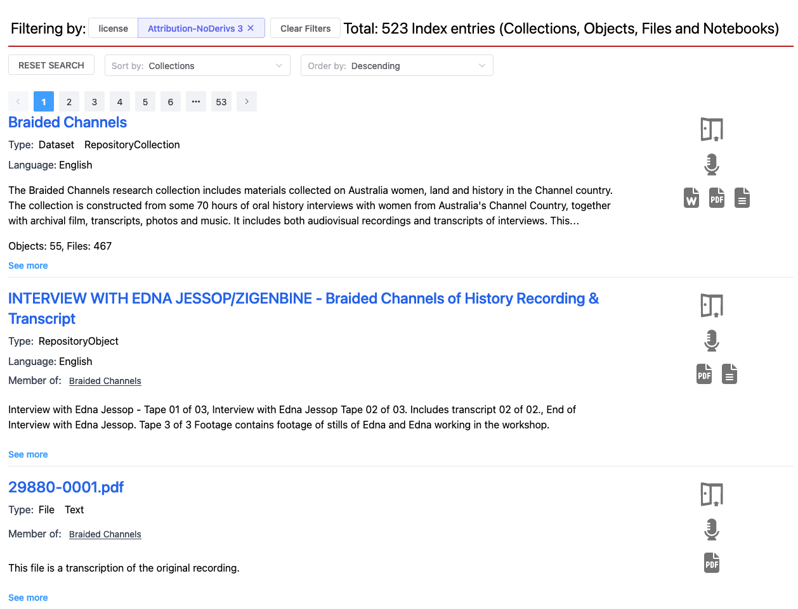
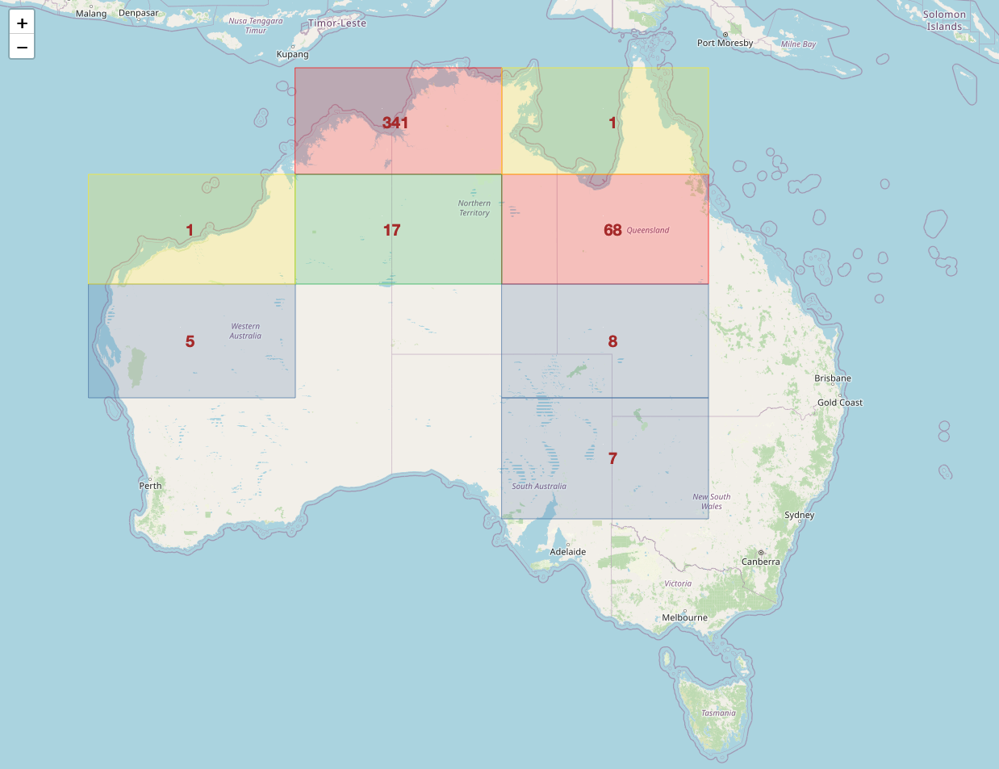
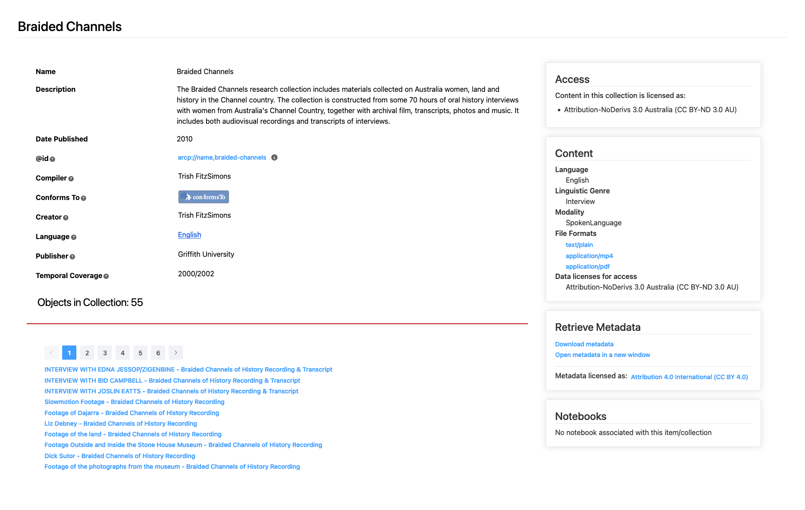
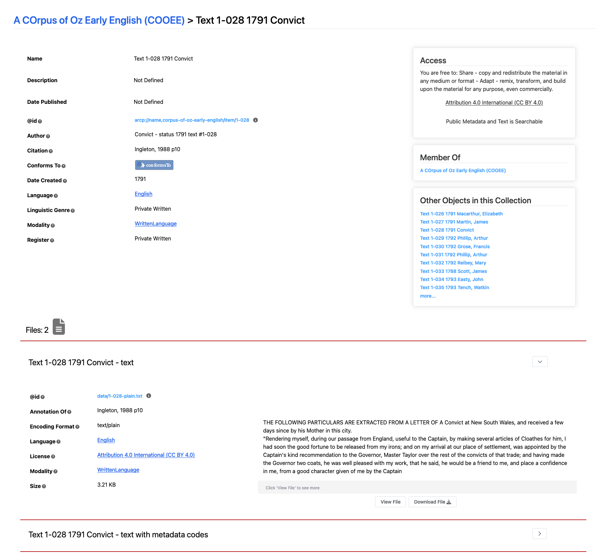
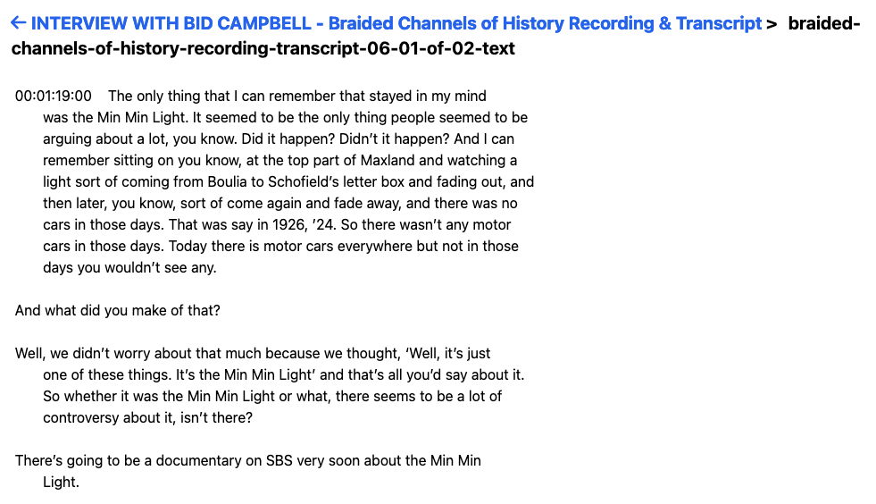

 

> This user guide uses 'portal' to refer to the interface across all of the available <GlossaryLink display="Oni" id="oni" /> portals (see [Available portals](/working-with-data/find-access/#available-portals) for more details).

 

- [Data and page structure](#data-and-page-structure)
- [Home page](#home-page) ([top menu](#top-menu), [left panel](#left-panel), [main panel](#main-panel))
- [Collection page](#collection-page)
- [Object page](#object-page) ([notebooks](#notebooks))
- [File page](#file-page)

 

## Data and page structure

Both the data and the webpages in the portal are structured in a heirarchy: Collections contain Objects and Objects contain Files.

| Level      | Description                                                                                                                                                                                                                                                                                     |
| ---------- | ----------------------------------------------------------------------------------------------------------------------------------------------------------------------------------------------------------------------------------------------------------------------------------------------- |
| Collection | A group of related Objects. Examples of collections include corpora, and sub-corpora, as well as aggregations of cultural objects such as <GlossaryLink display="PARADISEC" id="paradisec" /> collections, which bring together items collected in a region or a session with consultants. |
| ↓          |
| Object     | A single resource or a group of tightly related resources that record a communicative event; for example, a dialogue or session in a speech study, a work (document) in a written corpus.                                                                                                       |
| ↓          |
| File       | A container for data (in the form of bits and bytes). Files can store data in different formats; for example, a single Object could have an audio file as well as a text file containing a transcription of the audio.                                                                          |

 

## Home page

There are three main sections of the home page in the portal: the top menu bar, the left panel and the main panel. Each of these is discussed below.

 

<figure>
    
    <figcaption>Home Page: Top Menu, Left Panel and Main Panel sections</figcaption>
</figure>

 

### Top menu

 

<figure>
    
    <figcaption>Home Page: Top Menu</figcaption>
</figure>

 

The top menu of the home page allows you to access some of the main features of the portal:

- **_LDaCA logo_**: Returns you to the home page from anywhere in the portal.
- **_Collections_**: Filters the results section of the main panel so that only collections are shown (excluding objects, files and notebooks). A search performed while in this view will only search the text in the _Name_ and _Description_ fields at the collection level.
- **_Notebooks_**: Filters the results section of the main panel so that only <GlossaryLink display="Jupyter notebooks" id="jupyter-notebook" /> associated with collections are shown.
- **_Browse_**: Resets your results to the default settings.
- **_Login_**: Takes you to the CILogon page where you can login to apply for access to collections or view your current access. See [Login](/resources/guides/portal/login/) for more details.
- **_Help_**: Provides more general information about the infrastructure the portal was built with, as well as the <GlossaryLink display="Oni" id="oni" /> <GlossaryLink display="API" id="api" /> functionalities. It also links back to this user guide for easy reference.

 

### Left panel

 

<figure>
    
    <figcaption>Home Page: Left Panel</figcaption>
</figure>

 

The left panel of the portal home page allows you to refine your data query through the use of a search field and filters. Searching allows you to view records which include specific information, while filtering allows you to view records which share values for <GlossaryLink display="metadata" id="metadata" /> categories. Hovering over the information icon  next to each filter will display tooltips related to that filter. See [Search](/resources/guides/portal/search/) and [Filters](/resources/guides/portal/filters/) for more details on how to use the search and filter functions.

### Main panel

The main panel has two views available: [List View](#list-view) and [Map View](#map-view).

> Note that if you switch views, all current search and filter options will be reset.

#### List view

By default, the main panel is displayed in **_List View_**, which shows the results as a list. This is the alternative to [Map View](#map-view).

<figure>
    
    <figcaption>Home page: Main panel</figcaption>
</figure>

The main panel on the right of the home page allows you to view the top-level descriptions of collections, objects, files and notebooks in the portal. The top row shows the total number of Index entries or items; this total will reduce as you apply filters and search queries. Below this is the option to **_Reset search_**, clearing all (current) filters and searches. The **_Sort by_** and **_Order by_** dropdown boxes can also be configured; see [Sort and order](/resources/guides/portal/sort-and-order/) to learn more about their usage. Below this, there is a row of buttons which allow you to navigate through pages of results, with 10 results appearing on each page.

The results in the main panel contain a set of top-level descriptions:

- **Name**: The name of the collection, object, file or notebook.
- **Type**: The type of object a record describes, i.e. a collection, object or file.
- **Language**: The language(s) of the materials (including PrimaryMaterials, DerivedMaterials and Annotations) in this item.
- **Description**: An abstract of the collection, object, file or notebook.
- **Members**: The number of items (objects, files, etc.) within the given collection.
- **Member of**: The collection that an object, file or notebook is a part of.

> Note that top-level descriptions will not appear in cases where they aren't provided for that item, e.g. usually _Description_ is not present for objects and files, and _Member of_ does not appear for top-level collections.

##### Item icons

The icons next to each item show you some important information about that item (Access, Communication Mode and File Format). You can hover over a icon to see more detail.

| Icon                                                             | Category           | Icon Tooltip                                                                                                    |
| ---------------------------------------------------------------- | ------------------ | --------------------------------------------------------------------------------------------------------------- |
|                    | Access             | You can access this data immediately. By doing so, you accept the license terms specified on the record.        |
|                      | Access             | You can access this data after logging in. You may also have to agree to license terms in an automatic process. |
|             | Access             | There are restrictions on access to this data. Log in to get further information.                               |
|    | Communication Mode | SpokenLanguage                                                                                                  |
|  | Communication Mode | WrittenLanguage                                                                                                 |
|    | Communication Mode | SignedLanguage                                                                                                  |
|             | File Format        | text/plain                                                                                                      |
|             | File Format        | application/msword                                                                                              |
|             | File Format        | application/tei+xml application/vnd.openxmlformats-officedocument.wordprocessingml.document                  |
|           | File Format        | audio/mpeg audio/x-wav                                                                                       |
|           | File Format        | application/mp4                                                                                                 |
|               | File Format        | text/csv                                                                                                        |
|               | File Format        | application/pdf                                                                                                 |

#### Map view

Selecting **_Map View_** from the top row of the main panel will display results on a map. This is the alternative to [List View](#list-view).

<figure>
    
    <figcaption>Home Page: Map View</figcaption>
</figure>

Both filter and search functions work much the same as in **_List View_**, however advanced search is not available. The results on **_Map View_** are displayed in grids, and these divide further into more specific grids as you zoom in. The colours vary depending on the number of results per grid. The results displayed in **_Map View_** are only those in the current visible map area, so in order to view other results, either resize the map or move it to a different section.

> Note that only items with location data will be shown in **_Map View_**.

## Collection page

Clicking on one of the collections from the main page results will take you to the Collection page for that item.

<figure>
    
    <figcaption>Collection page: Braided Channels example</figcaption>
</figure>

The main panel of the Collection page lists the main details and <GlossaryLink display="metadata" id="metadata" /> associated with the collection. Clicking on the question mark icon  or information icon  next to each heading will display tooltips related to that item.

Below the main description and <GlossaryLink display="metadata" id="metadata" /> is the number of objects present in the collection. The objects are then listed below, with buttons allowing navigation by page if there are more than 10 objects in the collection.

The right panel has the following sections:

- **Access**: Defines the license and <GlossaryLink display="access conditions" id="access-conditions" /> for the current collection. <!--TODO (together with a click-through link to the full license - this isn't the case currently).-->
- **Content**: Lists some of the main features of the current collection including _Language_, _Linguistic Genre_, _Communication Mode_, _File Formats_ and _Data licenses for access_.
- **Downloads**: Displays the downloads associated with the current collection. **_Show All Downloads_** provides a more detailed view, particularly for distributed collections that can't be downloaded in a single ZIP file.
- **Retrieve Metadata**: View or download the <GlossaryLink display="metadata" id="metadata" /> associated with the current collection, as well as the license and <GlossaryLink display="access conditions" id="access-conditions" /> for this metadata.
- **Notebooks**: Lists any notebooks associated with the current collection.
- **Takedown Request**: Links to a form for users to make requests for data to be removed.

 

## Object page

Clicking on one of the objects or files from either the main page results or from a Collection page will take you to the Object page for that item.

 

<figure>
    
    <figcaption>Object Page: A Corpus of Oz Early English Example</figcaption>
</figure>

 

The left panel of the Object page lists the main details and <GlossaryLink display="metadata" id="metadata" /> associated with the object. Clicking on the question mark icon  or information icon  next to each heading will display tooltips related to that item.

The right panel has the following sections:

- **Access**: Defines the license and <GlossaryLink display="access conditions" id="access-conditions" /> for the current object, together with a click-through link to the full license.
- **Downloads**: Displays the downloads associated with the current object. _Show All Downloads_ provides a more detailed view, particularly for distributed collections that can't be downloaded in a single ZIP file.
- **Member Of**: Lists the collection that the current object is a part of.
- **Other Objects in this Collection**: Lists the other objects that are in the same collection as the current object.
- **Takedown Request**: Links to a form for users to make requests for data to be removed.

The end of the Object page provides details about the files that form part of the current object. In the example above, the object _Text 1-028 1791 Convict_ has two associated files: a plain text version and a text version including <GlossaryLink display="metadata" id="metadata" /> codes, the details of which can be viewed using the dropdown arrow to the right of the file name. A preview of the file is available (provided that the <GlossaryLink display="access conditions" id="access-conditions" /> permit this), and there are two options: **_View File_** to display the full file in the web browser, and **_Download File_** to save a copy of the file to your local system.

### Notebooks

Clicking on one of the <GlossaryLink display="notebooks" id="jupyter-notebook" /> from either the main page results or from a Collection page will take you to the Notebook page for that item.

 <!-- TODO add image when notebooks page is more finalised-->

The left panel of the Notebook page lists the main details and <GlossaryLink display="metadata" id="metadata" /> associated with the notebook. Clicking on the question mark icon  or information icon  next to each heading will display tooltips related to that item.

The right panel has the following sections:

- **Downloads**: Displays the downloads associated with the current notebook. **_Show All Downloads_** provides a more detailed view, particularly for distributed collections that can't be downloaded in a single ZIP file.
- **Try this Notebook**: Displays the <GlossaryLink display="BinderHub" id="binderhub" /> deployments which the current notebook can be launched in. The icons on the right show if any authentication is required to access each deployment.
- **Takedown Request**: Links to a form for users to make requests for data to be removed.

## File page

Clicking **_View File_** on one of the files in an Object page will take you the File page for that item.

<figure>
    
    <figcaption>File page: Braided Channels example</figcaption>
</figure>

From this page, you can view the whole file or download it with the option at the end of the page.
