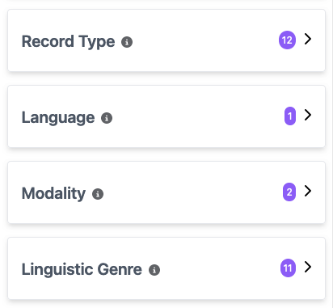
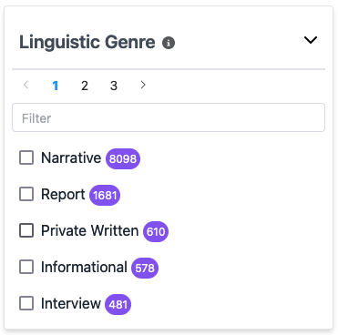

 

> This user guide uses 'portal' to refer to the interface across all of the available <GlossaryLink display="Oni" id="oni" /> portals (see [Available portals](/working-with-data/find-access/#available-portals) for more details).

 

Filters allow you to refine what items are available to view and search according to a set of major <GlossaryLink display="metadata" id="metadata" /> categories and can be accessed from the left panel of the portal home page. Select a filter in order to see the dropdown list of options; the number icons beside each filter indicate how many options are available. A total of five options are visible per page; to access more options, use the pagination icons, or the search bar if you are looking for a particular option.

 

Part of the Filter List | Linguistic Genre Filter Expanded
:---: | :---:
 | 

 

Within each filter, the number icons beside each option indicate how many items are available for that particular option. For example, in the images above, there are 11 options under the _Linguistic Genre_ filter, and there are 8098 items available for the linguistic genre _Narrative_.

Once you have selected all the filters you wish to apply, select the ___Apply Filters___ button, which appears on a floating pop-up box and also above the ___Reset Search___ button. The top of the results section will show the filters and selected options that were applied next to the _Filtering by:_ heading, and these can either be removed individually by clicking the __×__ next to that filter or in bulk with the ___Clear Filters___ button.

If needed, you can further select or deselect options by repeating this process with the left panel filters, at which point the ___Apply Filters___ button will reappear.

 

## Filter categories

 

### Collection

A group of related objects such as a corpus, a sub-corpus or items collected in a single <GlossaryLink display="data collection" id="data-collection" /> session.

__Examples:__
- A COrpus of Oz Early English (COOEE)
- Braided Channels
- International Corpus of English (ICE-AUS)

 

### Sub-collection

The sub-collections, if any, that comprise a <GlossaryLink display="collection" id="collection" />.

__Examples:__
- ICE: S1A: Conversations
- ICE: S2A: Dialogues
- ICE: S2B: Monologues

 

### Access

The <GlossaryLink display="access conditions" id="access-conditions" /> associated with an item. Note that these differ from the three general categories of the [Access icons](resources/guides/portal/basic-navigation/#item-icons) and are instead the specific licenses for the item's usage.

__Examples:__
- Attribution-NonCommercial 4.0 International (CC BY-NC 4.0)
- Attribution 4.0 International (CC BY 4.0)
- Attribution-NoDerivs 3.0 Australia (CC BY-ND 3.0 AU)

 

### Record type

The type or categorisation of an item, i.e. a <GlossaryLink display="collection" id="collection" />, <GlossaryLink display="object" id="object" /> or file. For individual files, this field also gives information about the nature of the material, i.e. primary material, transcription, annotation etc.

__Examples:__
- Annotation
- Video
- Transcription

 

### Language

The language(s) which the content of the item is in.

__Examples:__
- English
- Waanyi
- Vietnamese

 

### Communication mode

The mode(s) (spoken, written, signed, etc.) in which the content of the resource was created.

__Examples:__
- WrittenLanguage
- SpokenLanguage
- SignedLanguage

 

### Linguistic genre

The style or form of communication to which the item can be assigned.

__Examples:__
- Narrative
- Report
- Interview

 

### File format

The media type and encoding format of the file.

__Examples:__
- text/plain (.txt)
- application/mp4 (.mp4)
- audio/x-wav (.wav)

 